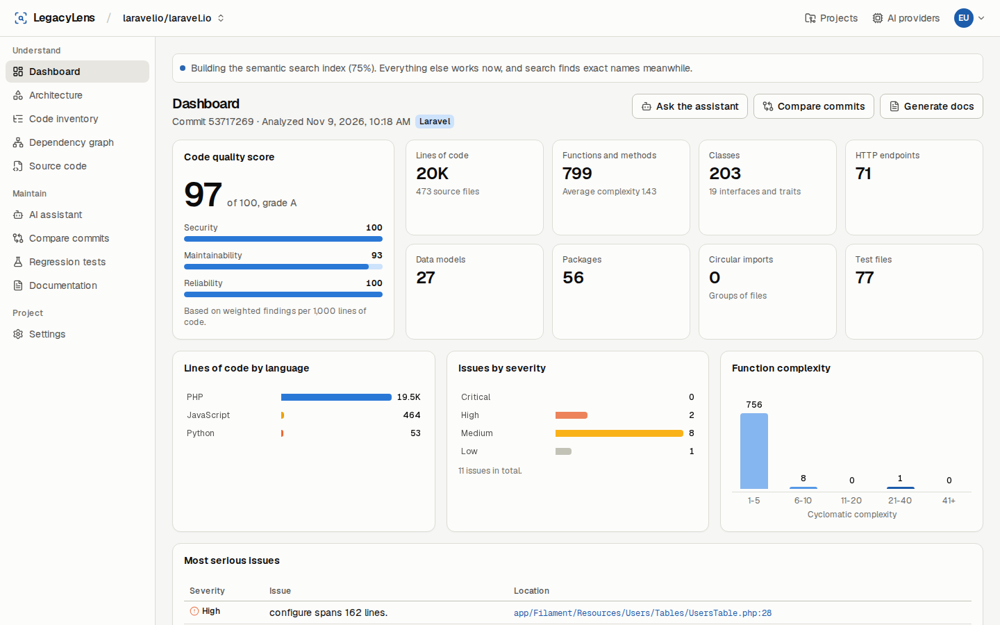
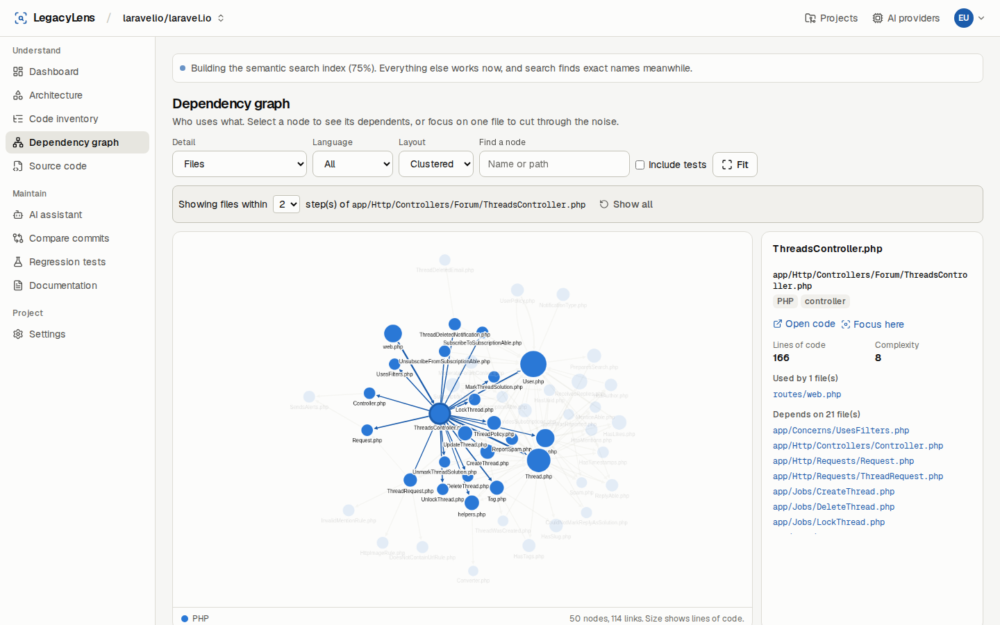

# LegacyLens

LegacyLens helps you understand and safely change legacy code. Import a GitHub repository or
upload a ZIP. It maps the architecture, draws the dependency graph, answers questions with exact
file and line references, shows what a commit could break, writes and runs regression tests in a
sandbox, and generates documentation.

It uses **no paid AI APIs**. It runs on Google Gemini's free tier, Groq's free tier, and local
models through Ollama. Scanning, the graph, commit comparison, the dashboard, baseline tests and
factual documentation all work with no AI provider at all.

**Supported code:** PHP, Laravel, Drupal 7 and 8+, Python (Flask, FastAPI, Django, SQLAlchemy,
SQLModel), JavaScript, TypeScript and Node.js (Express, NestJS, Mongoose, Sequelize, TypeORM, Prisma).



## Features

| Feature | What it does |
| --- | --- |
| Import | Clones public or private GitHub repositories, or takes a ZIP. Every ZIP upload becomes a version you can compare. |
| Architecture | Frameworks, entry points, layers, modules, Drupal hooks and circular imports. |
| Code inventory | Functions, classes, HTTP endpoints, data models, packages and quality issues, all searchable and linked to the exact lines. |
| Dependency graph | Interactive graph at module, file or function level, with search and focus on one file. |
| AI assistant | Answers from the retrieved code. Citations are checked against that code and open the exact lines. |
| Commit comparison | Changed symbols, affected modules and endpoints, and scored risks with evidence. |
| Regression tests | pytest, `node:test` or PHPUnit tests, run in locked-down Docker containers. |
| Documentation | Architecture, API reference, data models, components and dependencies, as Markdown. |
| Dashboard | Quality score, complexity, issues by severity, and the riskiest functions and files. |
| Accounts | Sign-in, password change, sign out everywhere, and account deletion. |



## Quick start

You need Docker with Compose, at least 4 GB of free memory and 12 GB of free disk.

```bash
make up          # Creates .env with random secrets, then builds and starts everything
```

Without `make`:

```bash
cp .env.example .env     # Then set SECRET_KEY and POSTGRES_PASSWORD
docker compose up --build -d
```

Open <http://localhost:3000> and create an account.

The first start takes several minutes, because it builds the images and the sandbox runners. The
first analysis also downloads the embedding model, which is about 90 MB.

A project can be used as soon as its analysis is saved. The semantic search index is then built in
the background, which takes about a minute for a mid-sized repository and up to around 15 minutes
for a very large one. Search by exact names works in the meantime.

### Turn on AI

Everything except AI answers already works. To add AI, set at least one of these in `.env`, then
run `docker compose up -d backend`:

| Provider | Setup | Where your code goes |
| --- | --- | --- |
| Gemini | Create a key at <https://aistudio.google.com/apikey>, set `GEMINI_API_KEY` | Google. On the free tier, Google may use it to improve its products. |
| Groq | Create a key at <https://console.groq.com/keys>, set `GROQ_API_KEY` | Groq's cloud service. |
| Ollama | See below. No key. | Stays on your machine. |

```bash
docker compose --profile ollama up -d
docker compose exec ollama ollama pull qwen2.5-coder:1.5b
```

The **AI providers** page shows each model's status and usage, and can send a test request.
A small local model is useful for trying LegacyLens, but it makes mistakes that larger models do
not. Its answers and documentation are labelled as AI-written for that reason.

## AI providers and the free-only guarantee

**Switching.** Providers are tried in the order set by `LLM_PROVIDER_ORDER`. Each user can reorder
them on the AI providers page, and can pick one provider for a single question.

**Automatic fallback.** When a model reports that its quota is used up, LegacyLens remembers when
it will be available again, in the database so a restart keeps honoring it, and moves on to the
next model. It does the same for timeouts, server errors and rejected keys. If nothing is
available, the assistant still returns the most relevant code references, and tests and
documentation fall back to versions that need no AI.

**What stops paid usage:**

- Only Gemini, Groq and Ollama clients exist in the code. Any other provider name is refused at startup.
- The Gemini and Groq addresses are constants in the code, so configuration cannot redirect them.
- Gemini models outside the Flash, Flash-Lite and Gemma families are refused at startup, because the Pro and flagship models have no free tier.
- Ollama's `:cloud` models and `ollama.com` addresses are refused at startup.
- Paid request options, such as Groq flex processing, are never sent.
- Local daily and per-minute budgets stop calls before the provider's own limit, and per-user rate limits stop one account from using up the shared quota.

> [!IMPORTANT]
> **Only you can control billing on your account.** An API client cannot see or change it.
> Linking a billing account to a Google project moves it to a paid tier, after which requests with
> that project's key are charged. Use a Google AI Studio project with **no billing account
> linked**, and keep your Groq organization on the **Free plan**. The local budgets limit the
> damage if a key is on a paid plan by mistake, but they are not a substitute for this.

> [!WARNING]
> **Private or client code.** Content sent through Gemini's free tier may be used by Google to
> improve its products. For code you may not share, open **Project settings** and turn on
> **Use local AI only**. The server then sends that project's code only to Ollama, and a request
> cannot override this.

Free-tier models and limits change often. The defaults were checked in November 2026. To change
models, edit `GEMINI_MODELS`, `GROQ_MODELS` and `OLLAMA_MODELS`. Each list is tried in order, and
each model has its own quota.

## How it is built

```text
Browser ── Next.js (React, Tailwind) ── FastAPI ─┬─ PostgreSQL   analysis, users, history
                                                 ├─ FAISS        per-project vector index
                                                 ├─ Sentence Transformers   local embeddings
                                                 ├─ Gemini / Groq / Ollama  through the fallback router
                                                 └─ Nested Docker engine ── throwaway test containers
```

See [docs/ARCHITECTURE.md](docs/ARCHITECTURE.md) for the analysis pipeline, retrieval, commit
comparison and the data model.

**How the quality score works.** Each finding is weighted by severity: low 0.5, medium 2,
high 5, critical 12. A category scores `100 × e^(−(weight per 1,000 lines) / 25)`. The overall
score weighs security 40%, maintainability 40% and reliability 20%. A high severity security
finding limits the overall score to 89, and a critical one to 59. Tests and example code are not
scored.

## What has been verified

Each of these was imported from GitHub and checked against counts taken independently with `grep`.

| Repository | Stack | What was checked |
| --- | --- | --- |
| laravelio/laravel.io | Laravel | All 71 routes, 7 Eloquent models and 202 classes found |
| drupal/drupal, branch 7.x | Drupal 7 | 5,930 functions, 318 `hook_menu` routes and the schema tables match |
| drupalcommerce/commerce | Drupal 8+ | Routing files match, and 22 entity types found with their base fields |
| lujakob/nestjs-realworld-example-app | NestJS, TypeORM | All 21 routes and 5 entities found |
| hagopj13/node-express-boilerplate | Express, Mongoose | Routes including `router.route()` chains, and both models |
| gothinkster/django-realworld-example-app | Django REST | All 6 models, and routes resolved through `include()` |
| fastapi/full-stack-fastapi-template | FastAPI, SQLModel | Routes, and only the 2 real tables counted as models |
| laravel/framework, pallets/flask, expressjs/express | Large libraries | Performance and stability |

Known gaps that showed up in this testing are listed under [Known limits](#known-limits).

## Security

Repositories, uploads, AI output and generated tests are all treated as untrusted. Tests run in
throwaway containers with no network, a read-only root, size-limited memory disks, no Linux
capabilities and strict resource limits, inside a nested Docker engine instead of on your host's
Docker socket. See [SECURITY.md](SECURITY.md) for the full model and its remaining risks.

**Before exposing it beyond your own machine:** serve it over HTTPS, set `COOKIE_SECURE=true`,
`FRONTEND_BIND=0.0.0.0` and `CORS_ORIGINS` to your address, and set `ALLOW_REGISTRATION=false`
once your accounts exist.

## Local development

```bash
make env venv frontend-install   # Create .env and install dependencies
make db                          # PostgreSQL on localhost:5433
make sandbox-images              # Test runner images on your local Docker engine
make backend                     # API on http://localhost:8000, docs at /api/docs
make frontend                    # Web app on http://localhost:3000
```

## Tests

```bash
make db sandbox-images   # Once, before the first run
make lint                # Backend lint and format check
make test                # Backend tests, type check, frontend lint and unit tests
make up && make e2e      # Browser tests against the running stack
```

Run `npx playwright install chromium` in `frontend/` once before the browser tests. Set
`E2E_NETWORK=1` to include the test that imports a real GitHub repository. Backend tests use a
real PostgreSQL database with the real migrations, and the sandbox tests start real containers.
They are skipped if Docker or the images are missing. [CONTRIBUTING.md](CONTRIBUTING.md) explains
the conventions.

## Configuration

All settings are environment variables. `.env.example` lists the common ones.

| Variable | Default | Purpose |
| --- | --- | --- |
| `LLM_PROVIDER_ORDER` | `gemini,groq,ollama` | Default fallback order |
| `GEMINI_MODELS`, `GROQ_MODELS`, `OLLAMA_MODELS` | See `.env.example` | Models tried for each provider |
| `GEMINI_DAILY_REQUEST_BUDGET`, `GROQ_DAILY_REQUEST_BUDGET` | `200`, `800` | Local daily limit per model |
| `GEMINI_MINUTE_REQUEST_BUDGET`, `GROQ_MINUTE_REQUEST_BUDGET` | `10`, `25` | Local per-minute limit per model |
| `RATE_LIMIT_AI_PER_MINUTE` | `20` | AI requests per user |
| `RATE_LIMIT_IMPORTS_PER_HOUR` | `30` | Imports per user |
| `RATE_LIMIT_TEST_RUNS_PER_MINUTE` | `10` | Sandbox runs per user |
| `MAX_PROJECTS_PER_USER` | `50` | Projects per account |
| `MAX_EMBEDDED_CHUNKS` | `20000` | Code sections embedded for semantic search |
| `EMBEDDING_MODEL` | `sentence-transformers/all-MiniLM-L6-v2` | Local embedding model |
| `MAX_UPLOAD_MB`, `MAX_EXTRACTED_MB`, `MAX_REPO_MB` | `200`, `1024`, `2048` | Import limits. Raising the upload limit also needs `proxyClientMaxBodySize` in `frontend/next.config.ts`. |
| `SANDBOX_ENABLED` | `true` | Allow running tests |
| `SANDBOX_TIMEOUT_SECONDS`, `SANDBOX_MEMORY_MB`, `SANDBOX_CPUS` | `180`, `1024`, `1.0` | Limits for each test run |
| `CORS_ORIGINS` | `http://localhost:3000` | Address people use to open LegacyLens |
| `ALLOW_REGISTRATION`, `COOKIE_SECURE` | `true`, `false` | Account settings |

## Known limits

- **Graph accuracy.** Calls are resolved from imports and type hints. A call on an untyped variable, such as `$x->save()`, creates no edge, because guessing would invent dependencies.
- **Route prefixes set at runtime are not known.** Examples are a FastAPI prefix read from settings, or Express routers mounted in a loop. The routes are found, without that prefix.
- **Commit comparison.** Changed symbols come from parsing both commits. Dependents come from the latest analyzed commit, and the result says so when the two differ.
- **Security rules** match patterns line by line. They help with triage, but they do not replace a dedicated security scanner.
- **Generated tests need review.** AI tests can expect the wrong result, and code that needs a database or a framework bootstrap needs mocks or manual edits. A baseline test only proves that the file parses and its symbols still exist.
- **Search on very large projects.** Semantic search covers the most important 20,000 code sections, and tests are left out once a project is large. Search by exact name covers everything.
- **Single server process.** Background jobs run in threads inside the API process. A restart marks running jobs as failed, and you can start them again.
- **Large uploads** are held in the web container's memory while they pass through, up to the 200 MB limit.

## Troubleshooting

| Symptom | Cause and fix |
| --- | --- |
| Backend exits at startup with a settings error | A value was rejected, for example a paid model or a short `SECRET_KEY`. The message names it. |
| "No AI provider is reachable" | No key is set and Ollama is not running. See [Turn on AI](#turn-on-ai). |
| Ollama shows "Model not found" | Run `docker compose exec ollama ollama pull <model>`. |
| Tests say a sandbox image is missing | Run `docker compose up sandbox-images`, or `make sandbox-images` when developing locally. |
| "This request came from another site" | Set `CORS_ORIGINS` to the address in your browser's address bar. |
| "Semantic search is unavailable" | The embedding model could not download. Search by exact name still works. Check network access, then use **Analyze again**. |

## License

No license has been chosen yet. Until one is added, the code is not open source, and others may
not reuse it. Add a `LICENSE` file before publishing if you want to allow that.
