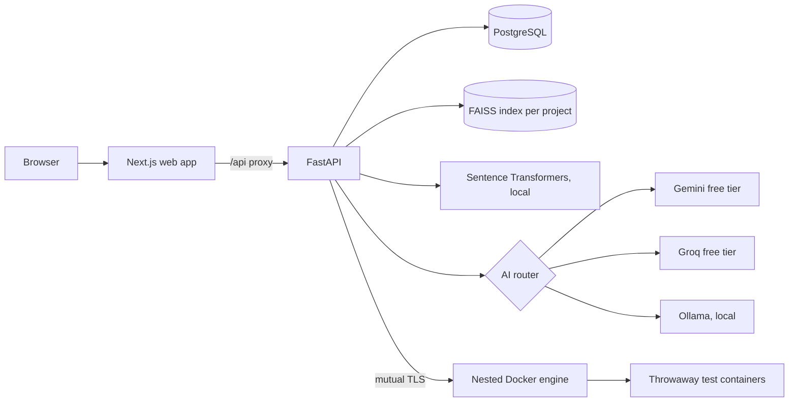

# Architecture

## Analysis pipeline

An import or update runs as a background job.

1. **Bring in the code.** A GitHub clone, or a ZIP extracted to a staging folder. Every ZIP becomes a commit in LegacyLens' own git repository, so uploads can be compared.
2. **Scan.** Find files, skip dependencies and generated code, and classify each file's role. Tests and examples are kept out of the product's metrics.
3. **Parse.** Tree-sitter extracts symbols, imports, calls, routes and models. It tolerates errors, so Python 2 and old PHP still yield results.
4. **Build the graph.** Imports and calls are resolved across files. A call that cannot be resolved creates no edge, because guessing would invent dependencies.
5. **Check quality.** Structural rules and line rules produce findings, each with a file and line.
6. **Save.** The project is usable from this point.
7. **Build the search index.** Local embeddings run in the background, and keyword search works in the meantime. Vectors of unchanged code are reused.

| Stage | Code |
| --- | --- |
| Ingestion | `backend/app/services/ingest.py`, `git.py` |
| Scanning and parsing | `backend/app/services/analysis/scanner.py`, `languages/`, `frameworks.py` |
| Graph | `backend/app/services/analysis/graph.py` |
| Quality | `backend/app/services/analysis/quality.py` |
| Orchestration | `backend/app/services/analysis/pipeline.py`, `projects.py`, `jobs.py` |
| Search | `backend/app/services/retrieval.py` |

## Answering a question

1. Search with the question, plus the previous question if it is a short follow-up.
2. Merge vector and keyword rankings with reciprocal rank fusion. Tests rank lower unless the question asks about them.
3. Build a prompt from the excerpts, with real line numbers and secrets removed.
4. The router tries each allowed model in order, skipping any that is out of quota or over its local budget.
5. Check each citation against the retrieved code. A citation that does not match is marked as unverified. If the model cited nothing, references are found from the code it names.

If no provider is available, the answer lists the most relevant code without AI.

**How retrieval was tuned.** Changes are measured on real repositories with questions whose answer
file is known, and kept only if they help. On 32 questions about Flask and laravel.io, adding root
words to the keyword search raised the right file into the top three from 23 to 29 questions.
Adding file and symbol names as plain words to the embedded text made results worse, so it was
left out.

## Commit comparison

Changed symbols come from parsing both commits and comparing each symbol's body and signature.
Dependents come from a reverse walk of the stored graph, up to three steps. Risk rules then look
for patterns such as a removed function that is still used, a changed signature with outside
callers, schema changes and changes to sensitive code. Each finding carries its evidence.

## Test sandbox

Without dependency install, one container receives the project as a tar stream on stdin, on a
memory disk, with no network. With dependency install, a volume holds the project, one container
installs with network access and scripts disabled, and a final container runs the tests with no
network and the volume read-only. See [SECURITY.md](../SECURITY.md).

## Data model

| Tables | Purpose |
| --- | --- |
| `users` | Accounts, session version, preferred provider order |
| `projects`, `jobs` | Projects, stored summary, background job progress |
| `source_files`, `symbols`, `graph_edges` | The code model |
| `api_endpoints`, `data_models`, `package_dependencies`, `quality_issues` | The inventory |
| `code_chunks` | Retrievable code. A chunk's id is also its id in FAISS. |
| `conversations`, `messages`, `comparisons`, `generated_tests`, `test_runs`, `documents` | Saved results |
| `llm_usage`, `provider_cooldowns` | Local budgets and quota state, which survive a restart |

Re-analysis replaces the code model in one transaction. Saved results such as chats, comparisons,
tests and documents are kept.
